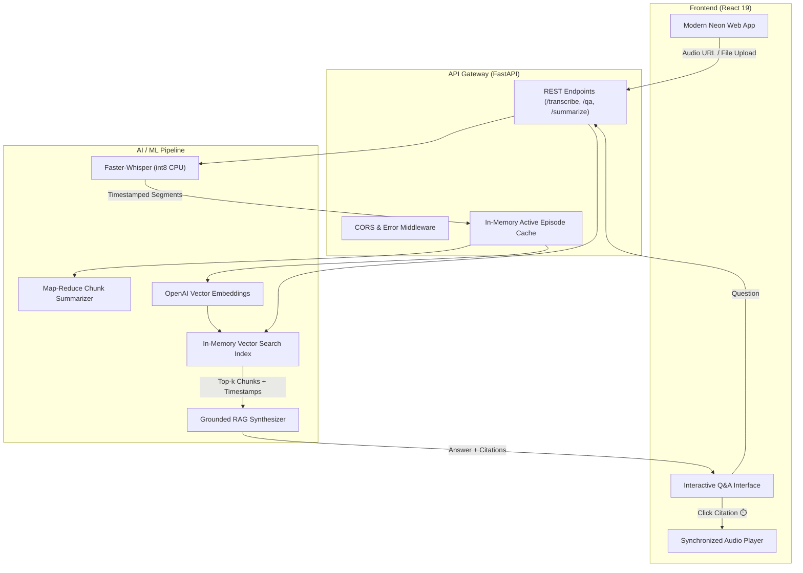

# ChatPod 🎙️ 🤖

[](https://www.python.org/)
[](https://fastapi.tiangolo.com/)
[](https://react.dev/)
[](https://platform.openai.com/)
[](https://github.com/SYSTRAN/faster-whisper)
[]()
[](https://www.docker.com/)

> **ChatPod** is a full-stack, AI-powered podcast intelligence engine. It transcribes audio streams using quantized Whisper models, synthesizes long-form executive summaries via a Map-Reduce LLM pipeline, and powers an interactive, conversational Retrieval-Augmented Generation (RAG) system with precision timestamp citations.

---

## 🏛️ System Architecture



---

## 🌟 Key Technical Highlights

- **Fast, Local Speech-to-Text (`faster-whisper`)**: Utilizes CTranslate2 with `int8` CPU quantization. Delivers up to **4x speedup** over vanilla Whisper with minimal memory overhead and zero external GPU requirements.
- **Map-Reduce Long-Form Summarization**: Overcomes LLM context window constraints on 1–2 hour podcast episodes by recursively chunking transcripts at sentence boundaries and synthesizing a cohesive executive summary.
- **Timestamped Grounded RAG (`embeddings.py` & `qa.py`)**: Indexes audio segments using OpenAI embeddings (`text-embedding-3-small`). Vector search retrieves relevant context passages, prompting the LLM to cite specific audio intervals (e.g. `[04:15 - 04:45]`) to prevent hallucinations.
- **Synchronized Audio & Citation Seeking**: Clicking any citation badge in the chat interface jumps the native HTML5 audio player directly to that exact second in the podcast.
- **Clean Architecture & Separation of Concerns**: Modernized from an early Colab/Flask prototype into a modular, production-ready backend with strict Pydantic v2 schemas and an offline-testable suite.
- **Deterministic Offline Testing**: 25 unit and integration tests with 100% mocked AI API calls, enabling fast, zero-cost CI execution.

---

## 📁 Repository Structure

```
Chat_Pod/
├── backend/                  # FastAPI Application & ML Services
│   ├── app/
│   │   ├── config.py         # Pydantic Settings & environment variables
│   │   ├── transcriber.py    # Local speech-to-text via faster-whisper
│   │   ├── summarizer.py     # Map-Reduce LLM summarization pipeline
│   │   ├── embeddings.py     # Vector embeddings, chunking & similarity search
│   │   ├── qa.py             # Grounded RAG conversational Q&A engine
│   │   ├── models.py         # Pydantic v2 request/response schemas
│   │   └── main.py           # FastAPI REST gateway & active session cache
│   ├── tests/                # Automated pytest suite (25 tests, offline/mocked)
│   ├── requirements.txt      # Curated backend dependencies (Python 3.12)
│   ├── Dockerfile            # Multi-stage Python 3.12 container
│   └── .env.example          # Backend environment template
├── frontend/                 # React 19 Single Page Application
│   ├── src/
│   │   ├── App.js            # Dual ingestion, sync player, and chat UI
│   │   └── App.css           # Futuristic neon cyberpunk styling
│   ├── Dockerfile            # Multi-stage Node + Nginx container
│   └── .env.example          # Frontend API endpoint configuration
├── contracts/                # System architecture & interface contracts
├── docs/                     # Interactive REST API documentation (api.md)
├── scripts/                  # Standalone CLI demo (cli_demo.py)
├── .github/workflows/        # Automated GitHub Actions CI pipeline
├── docker-compose.yml        # 1-Command multi-container orchestration
└── .gitignore                # Comprehensive Git exclusions
```

---

## ⚡ Quickstart

### Option 1: Docker Compose (Recommended)

1. Clone the repository:
   ```bash
   git clone https://github.com/ProVerted/ChatPod.git
   cd ChatPod
   ```

2. Configure environment:
   ```bash
   cp backend/.env.example backend/.env
   # Add your OPENAI_API_KEY to backend/.env
   ```

3. Launch the stack:
   ```bash
   docker compose up --build
   ```
   - **Frontend UI**: [http://localhost:3000](http://localhost:3000)
   - **FastAPI OpenAPI Docs**: [http://localhost:8000/docs](http://localhost:8000/docs)

---

### Option 2: Local Development

#### 1. Backend Setup
```bash
# Create Python 3.12 virtual environment
python -m venv venv

# Activate virtual environment
# Windows:
.\venv\Scripts\activate
# macOS / Linux:
source venv/bin/activate

# Install dependencies
pip install -r backend/requirements.txt

# Configure environment
cp backend/.env.example backend/.env

# Run FastAPI server
uvicorn app.main:app --app-dir backend --reload --port 8000
```

#### 2. Frontend Setup
```bash
cd frontend
npm install --legacy-peer-deps
npm start
```

---

## 🧪 Automated Testing

ChatPod includes a deterministic, offline pytest suite that mocks all heavy ML and OpenAI network calls:

```bash
pytest backend/tests -v
```

**Results**:
```
backend/tests/test_api.py ......                 [ 24%]
backend/tests/test_qa.py ...........             [ 68%]
backend/tests/test_summarizer.py .....           [ 88%]
backend/tests/test_transcriber.py ...            [100%]

====================== 25 passed in 3.28s ======================
```

---

## 📖 API Documentation

Complete REST API contracts, request payloads, and response definitions are available in [`docs/api.md`](docs/api.md) or via interactive Swagger at `http://localhost:8000/docs`.

---

## 📄 License

This project is licensed under the MIT License. See [LICENSE](contracts/LICENSE) for details.
